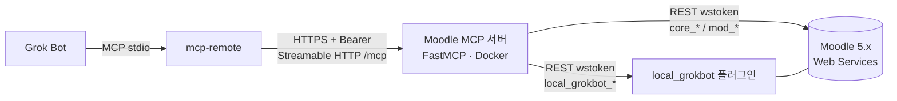

# Moodle Agent (Grok Bot × Moodle MCP)

> COURSEMOS팀 공유용 리포입니다. Grok Bot이 Moodle 강좌를 읽고, 만들고, 채점까지 돕도록 만든 MCP 서버와 동반 Moodle 플러그인을 한 곳에 모았어요. 토큰·비밀값·실서버 주소는 전부 빼거나 placeholder로 바꿨습니다.

## 개요
- **`src/moodle_mcp/`** — FastMCP(Python 3.12) 기반 Streamable-HTTP MCP 서버. Moodle 도구 **39개**(읽기 14 · 쓰기 25)를 노출하고, Bearer 토큰으로 보호합니다.
- **`plugins/local_grokbot/`** — 서버가 의존하는 Moodle 로컬 플러그인(v0.3.0, 웹서비스 함수 9개). 코어 WS에 없는 기능(모듈 생성/수정, 루브릭, 성적 카테고리, 배지 등)을 채워 줍니다.
- **`docs/`** — 통합 설계 메모, 공유 브리프, 강좌 8 데모 정리, 강좌 설계 자료(`moodle-design/`).
- 쓰기 도구는 전부 `confirm=false`로 미리보기 → 교사 승인 → `confirm=true`로 실행하는 2단계 방식입니다. (`grade_submission`/`bulk_grade`는 confirm 인자 없이 승인 후 호출)

## 아키텍처


## 도구 목록 (39)
| # | 이름 | 종류 | 설명 |
|---|---|---|---|
| 1 | `site_info` | 읽기 | Get Moodle site info and the identity of the web service user. |
| 2 | `list_courses` | 읽기 | List courses. |
| 3 | `get_course_outline` | 읽기 | Get the sections and activities/modules of a course. |
| 4 | `list_students` | 읽기 | List users enrolled in a course (with roles and groups). |
| 5 | `list_assignments` | 읽기 | List assignments, grouped by course. |
| 6 | `get_submissions` | 읽기 | Get submissions for assignments. |
| 7 | `get_assignment_grades` | 읽기 | Get grades already given for assignments (mod_assign_get_grades). |
| 8 | `gradebook_overview` | 읽기 | Get gradebook items and grades for a course, optionally for a single user. |
| 9 | `list_quizzes` | 읽기 | List quizzes in the given courses (omit for all accessible courses). |
| 10 | `list_quiz_attempts` | 읽기 | List a user's attempts on a quiz. |
| 11 | `review_attempt` | 읽기 | Get the full review (questions, responses, marks) of a quiz attempt. |
| 12 | `attendance_sessions` | 읽기 | List sessions (and attendance logs) of an attendance activity instance. |
| 13 | `list_categories` | 읽기 | List course categories (id, name, parent, coursecount). |
| 14 | `create_course` | 쓰기 | Create a course (core_course_create_courses) and enrol the bot as editingteacher. |
| 15 | `grade_submission` | 쓰기 | Save a grade and feedback comment for one student's assignment submission. |
| 16 | `bulk_grade` | 쓰기 | Save grades and feedback for several students of one assignment at once. |
| 17 | `create_assignment` | 쓰기 | Create an assignment in a course section. |
| 18 | `create_quiz` | 쓰기 | Create a quiz in a course section. |
| 19 | `create_forum` | 쓰기 | Create a forum in a course section. |
| 20 | `create_page` | 쓰기 | Create a page (HTML content) in a course section. |
| 21 | `create_resource` | 쓰기 | Upload a file and create a file resource in a course section. |
| 22 | `create_workshop` | 쓰기 | . |
| 23 | `create_wiki` | 쓰기 | . |
| 24 | `create_glossary` | 쓰기 | . |
| 25 | `create_feedback` | 쓰기 | . |
| 26 | `create_h5pactivity` | 쓰기 | . |
| 27 | `create_openmaic` | 쓰기 | . |
| 28 | `set_rubric` | 쓰기 | Define (or replace) the rubric of an activity. |
| 29 | `set_grade_categories` | 쓰기 | Organise the gradebook into weighted categories under the course total and move activities' grade items into them. |
| 30 | `create_badge` | 쓰기 | Create a course badge awarded when all activity_cmids are completed and/or the course is completed with at least min_course_grade. |
| 31 | `update_activity` | 쓰기 | Update an activity (local_grokbot_update_module). |
| 32 | `set_activity_visibility` | 쓰기 | Show or hide an activity on the course page. |
| 33 | `set_completion` | 쓰기 | Set the completion rule of an activity. |
| 34 | `set_access_restriction` | 쓰기 | Restrict access to an activity (target = cmid) or a section (target = section number): require completion of required_cmids and/or a start date open_from (unix timestamp). |
| 35 | `add_quiz_questions` | 쓰기 | Create questions and add them to a quiz (quiz_id = quiz instance id, not cmid). |
| 36 | `add_sections` | 쓰기 | Append sections to a course. |
| 37 | `update_section` | 쓰기 | Rename a course section and/or change its summary (HTML). |
| 38 | `post_forum_discussion` | 쓰기 | Post a new discussion to a forum (forum_id = forum instance id). |
| 39 | `list_forum_discussions` | 읽기 | List the discussions of a forum (forum instance id) with all their posts. |

## 설치 / 배포
### 1. Moodle 쪽 준비
1. `plugins/local_grokbot`을 Moodle의 `local/grokbot`에 복사 → 관리자 화면에서 업그레이드(알림) 실행.
2. 사이트 관리 → 고급 기능 → **웹 서비스 활성화**, 관리 → 플러그인 → 웹 서비스 → **REST 프로토콜 활성화**.
3. 전용 서비스 사용자(예: `svc_grokbot`) 생성. admin 계정 토큰은 쓰지 마세요.
4. 외부 서비스 생성(읽기용/쓰기용 분리 권장) → 필요한 `core_*`, `mod_*`, `local_grokbot_*` 함수 추가 → 허가된 사용자에 서비스 사용자 등록.
5. 서비스 사용자에 맞는 역할/권한 부여 후 **토큰 발급**(관리 → 웹 서비스 → 토큰 관리).

### 2. MCP 서버 실행 (docker compose)
```bash
cp .env.example .env      # 값 채우기 (커밋 금지)
#  MOODLE_WS_ENDPOINT=https://moodle.example.com/webservice/rest/server.php
#  MOODLE_TOKEN=<서비스 사용자 토큰>
#  MCP_BEARER_TOKEN=<길고 랜덤한 값, 예: openssl rand -hex 32>
#  MCP_PORT=8791
docker build -t moodle-mcp:p0 .
cp .env deploy/.env && cd deploy && docker compose up -d
curl http://localhost:8791/health
```
- compose는 `localhost`에만 바인딩하니, 외부 공개는 리버스 프록시(nginx/Caddy 등, TLS)로 `https://mcp.example.com/mcp` 형태로 열어 주세요.
- 로컬 개발: `pip install -r requirements-dev.txt && pytest`.

### 3. Grok Bot 연결
```bash
npx mcp-remote https://mcp.example.com/mcp --header "Authorization: Bearer ${MCP_BEARER_TOKEN}"
```
커넥터 도구 목록은 앱이 캐시하므로, 도구를 추가/변경하면 커넥터를 다시 추가해야 반영됩니다.

## 데모 시나리오 — 강좌 8 「AI 에이전트 시대의 교육」
자세한 내용은 [`docs/course8_share.md`](docs/course8_share.md).
1. 교사가 "테스트 강좌 만들어 줘" → `list_categories` + `create_course` 미리보기 → 승인 → 강좌 생성.
2. AI교수법 조교가 8차시 설계안 작성, 슬라이드 에이전트가 덱 8개(pptx+pdf) 제작 (`docs/moodle-design/`).
3. 무들봇이 81단계 빌드 계획을 단계별 미리보기로 제시 → 교사 승인.
4. 실행: `add_sections`/`update_section` → 차시별 `create_page`·`create_resource` → 퀴즈(`create_quiz`+`add_quiz_questions`), 포럼, 위키, 용어집, 과제, 워크숍, 설문, OpenMAIC 활동 → `set_rubric`·`set_completion`·`set_access_restriction`(순차 잠금)·`set_grade_categories`·`create_badge`.
5. 결과: 약 10분 만에 전체 빌드, 오류 0건.

## 관련 작업
- **mod_openmaic**(OpenMAIC Moodle 플러그인)은 별도로 관리되며 이 리포에는 포함되지 않습니다. 여기서는 `create_openmaic` 도구가 이미 설치된 모듈을 호출만 합니다.

## 참고
- 스크린샷은 관리자 이름이 노출돼 있고 크롭본이 없어 제외했습니다.
- 강의 영상(약 1.9GB)과 base64 중간 산출물은 용량 문제로 제외했습니다.
- 서버 원본 영문 README: [`docs/SERVER_README_en.md`](docs/SERVER_README_en.md)
