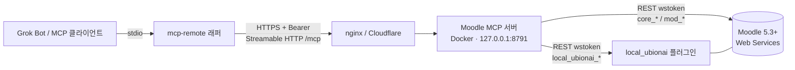

# Moodle Agent MCP — 설치 키트

> 우리 Moodle에 **AI 에이전트(Grok Bot 등 MCP 클라이언트)**를 붙여서 강좌 조회·생성·채점까지 바로 쓸 수 있게 해 주는 키트입니다. COURSEMOS팀 공유용. 토큰·비밀값·실서버 주소는 들어 있지 않아요.

## 데모 영상

[](https://youtu.be/3HzwHaY5cY8)

교수자의 한 줄 요청으로 에이전트가 MCP 도구 13번 호출만으로 강좌(4주차·읽기자료·과제·퀴즈·이수 조건)를 만드는 81초 영상이에요. [YouTube에서 보기](https://youtu.be/3HzwHaY5cY8)

## 들어 있는 것
| 경로 | 내용 |
|---|---|
| `src/moodle_mcp/`, `tests/` | FastMCP(Python 3.12) Streamable-HTTP MCP 서버 — 도구 **39개**, Bearer 인증 |
| `Dockerfile`, `deploy/docker-compose.yml`, `.env.example` | 컨테이너 빌드/실행 |
| [moodle-local_ubionai](https://github.com/scottnaddle/moodle-local_ubionai) (별도 리포) | 서버가 의존하는 Moodle 로컬 플러그인 `local_ubionai` (v0.1.0, WS 함수 9개). 이전 이름 `local_grokbot` |
| `moodle-setup/setup_ubionai_ws.php` | Moodle 쪽 자동 설정 CLI (웹서비스·REST·서비스 사용자·역할·외부 서비스·토큰) |
| `deploy/nginx/mcp.conf.template`, `deploy/TLS_CLOUDFLARE.md` | 리버스 프록시·TLS 템플릿 (도메인은 변수) |
| `client/moodle-mcp-remote.sh` | Grok Bot/아무 MCP 클라이언트용 stdio 래퍼 (mcp-remote) |
| `scripts/smoke_test.py` | 설치 후 동작 확인 |
| `INSTALL.md`, `ROLLBACK.md` | 설치 전 과정 / 업그레이드·롤백 |
| `docs/` | 통합 설계 메모, 프로젝트 브리프, 서버 영문 README |

👉 **설치는 [INSTALL.md](INSTALL.md)를 순서대로 따라가면 됩니다.**

## 아키텍처


## 도구 목록 (39)
- 읽기 14 · 쓰기 25. 쓰기 도구는 `confirm=false` 미리보기 → 사람 승인 → `confirm=true` 실행의 2단계입니다. (`grade_submission`/`bulk_grade`는 confirm 인자 없이 승인 후 호출)
- ⚠️선택 = 선택 플러그인이 필요한 도구. 플러그인이 없어도 서버·설정 스크립트는 정상 동작하고, 해당 도구만 `error` + `hint`를 돌려줍니다.
  - `attendance_sessions` → **mod_attendance**
  - `create_openmaic` → **mod_openmaic**

| # | 이름 | 종류 | 설명 |
|---|---|---|---|
| 1 | `site_info` | 읽기 | Get Moodle site info and the identity of the web service user. |
| 2 | `list_courses` | 읽기 | List courses. |
| 3 | `get_course_outline` | 읽기 | Get the sections and activities/modules of a course. |
| 4 | `list_students` | 읽기 | List users enrolled in a course (with roles and groups). |
| 5 | `list_assignments` | 읽기 | List assignments, grouped by course. Courses the service user is not enrolled in use the optional `local_ubionai_get_course_assignments` fallback and are tagged `source: local_ubionai`. |
| 6 | `get_submissions` | 읽기 | Get submissions for assignments. |
| 7 | `get_assignment_grades` | 읽기 | Get grades already given for assignments (mod_assign_get_grades). |
| 8 | `gradebook_overview` | 읽기 | Get gradebook items and grades for a course, optionally for a single user. |
| 9 | `list_quizzes` | 읽기 | List quizzes in the given courses (omit for all accessible courses). |
| 10 | `list_quiz_attempts` | 읽기 | List a user's attempts on a quiz. |
| 11 | `review_attempt` | 읽기 | Get the full review (questions, responses, marks) of a quiz attempt. |
| 12 | `attendance_sessions` ⚠️선택 | 읽기 | List sessions (and attendance logs) of an attendance activity instance. |
| 13 | `list_categories` | 읽기 | List course categories (id, name, parent, coursecount). |
| 14 | `create_course` | 쓰기 | Create a course (core_course_create_courses) and enrol the bot as editingteacher. |
| 15 | `grade_submission` | 쓰기 | Save a grade and feedback comment for one student's assignment submission. |
| 16 | `bulk_grade` | 쓰기 | Save grades and feedback for several students of one assignment at once. |
| 17 | `create_assignment` | 쓰기 | Create an assignment in a course section. |
| 18 | `create_quiz` | 쓰기 | Create a quiz in a course section. |
| 19 | `create_forum` | 쓰기 | Create a forum in a course section. |
| 20 | `create_page` | 쓰기 | Create a page (HTML content) in a course section. |
| 21 | `create_resource` | 쓰기 | Upload a file and create a file resource in a course section. |
| 22 | `create_workshop` | 쓰기 | . |
| 23 | `create_wiki` | 쓰기 | . |
| 24 | `create_glossary` | 쓰기 | . |
| 25 | `create_feedback` | 쓰기 | . |
| 26 | `create_h5pactivity` | 쓰기 | . |
| 27 | `create_openmaic` ⚠️선택 | 쓰기 | . |
| 28 | `set_rubric` | 쓰기 | Define (or replace) the rubric of an activity. |
| 29 | `set_grade_categories` | 쓰기 | Organise the gradebook into weighted categories under the course total and move activities' grade items into them. |
| 30 | `create_badge` | 쓰기 | Create a course badge awarded when all activity_cmids are completed and/or the course is completed with at least min_course_grade. |
| 31 | `update_activity` | 쓰기 | Update an activity (local_ubionai_update_module). |
| 32 | `set_activity_visibility` | 쓰기 | Show or hide an activity on the course page. |
| 33 | `set_completion` | 쓰기 | Set the completion rule of an activity. |
| 34 | `set_access_restriction` | 쓰기 | Restrict access to an activity (target = cmid) or a section (target = section number): require completion of required_cmids and/or a start date open_from (unix timestamp). |
| 35 | `add_quiz_questions` | 쓰기 | Create questions and add them to a quiz (quiz_id = quiz instance id, not cmid). |
| 36 | `add_sections` | 쓰기 | Append sections to a course. |
| 37 | `update_section` | 쓰기 | Rename a course section and/or change its summary (HTML). |
| 38 | `post_forum_discussion` | 쓰기 | Post a new discussion to a forum (forum_id = forum instance id). |
| 39 | `list_forum_discussions` | 읽기 | List the discussions of a forum (forum instance id) with all their posts. |

## 관련 작업
- **mod_openmaic**(OpenMAIC 기반 멀티에이전트 강의 Moodle 활동 플러그인)은 별도로 관리되며 이 리포에는 포함되지 않습니다. 설치돼 있으면 `create_openmaic`이 그 모듈을 만들어 줄 뿐입니다. 필요하면 담당자에게 따로 요청해 주세요.

## 보안 원칙 (요약)
- 토큰/`.env`는 절대 커밋하지 않기 (`.gitignore`에 포함). admin 토큰·`moodle_mobile_app` 토큰을 MCP에 쓰지 않기.
- 전용 서비스 사용자 + 제한된 외부 서비스(`restrictedusers=1`) + 가능하면 IP 제한.
- 실제 학생 데이터에 쓰기 전에 테스트 강좌/스테이징에서 먼저 확인. 자세한 내용은 INSTALL.md 7절.

## 교사별 OAuth (Easy Connect 시험, 스파이크 — 허브 멀티테넌트 모드 전용)
- claude.ai 커넥터에 `https://<허브>/t/<site>/mcp`만 넣으면 교사가 자기 Moodle 계정으로 로그인·동의하고, 도구는 그 교사의 WS 토큰(플러그인 서비스 `ubionai_user`)으로 실행됩니다. 사이트 관리자와 `moodle_mobile_app` 등 다른 서비스 토큰은 플러그인과 허브 양쪽에서 코드로 거부합니다. 테넌트 정적 Bearer는 그대로 동작합니다.
- 구현: `src/moodle_mcp/oauth.py`, 테스트 `tests/test_oauth.py`, 실 Moodle E2E `scripts/e2e_moodle_oauth.py`. 배포·환경변수·마이그레이션·롤백: [deploy/hub/SPIKE-OAUTH.md](deploy/hub/SPIKE-OAUTH.md)
- **허브↔플러그인 back-channel 비밀 프로비저닝** (값은 서버에서 직접 생성, 리포·채팅에 넣지 않음)
  - 허브: 환경변수 `UBIONAI_HUB_TENANT_SECRETS_DIR`(hub-staging compose: `/run/secrets/tenants` ← 호스트 `/opt/ubionai-hub/secrets/tenants` ro 마운트) 아래 **`<dir>/<site>/oauth.secret`** 파일이 있는 사이트만 OAuth가 켜집니다. 파일은 컨테이너 사용자 `10001` 소유, 권한 `0400`(그룹·기타 비트 금지), 32바이트 이상 한 줄. 조건에 안 맞으면 그 사이트만 OAuth off + 로그
  - 생성 (출력 없이):
    ```sh
    SITE=<site_id>
    sudo install -d -o root -g 10001 -m 0750 /opt/ubionai-hub/secrets/tenants /opt/ubionai-hub/secrets/tenants/$SITE
    sudo sh -c "umask 077; openssl rand -base64 48 | tr -d '\n' > /opt/ubionai-hub/secrets/tenants/$SITE/oauth.secret"
    sudo chown 10001:10001 /opt/ubionai-hub/secrets/tenants/$SITE/oauth.secret && sudo chmod 0400 /opt/ubionai-hub/secrets/tenants/$SITE/oauth.secret
    ```
  - Moodle: 같은 값을 플러그인 설정 `local_ubionai/oauth_secret`에, `local_ubionai/hub_site_id`=`<site>`, `local_ubionai/hub_url`=허브 공개 URL
  - 메시지 형식: `base64url(JSON) "." base64url(HMAC-SHA256(secret, "ubionai-oauth-v1." + body))`, 클레임 `typ`(authz_req/exchange/revoke)·`aud`(Moodle wwwroot)·`site`·`exp`(요청 10분, back-channel 60초)
- 공개 URL은 `UBIONAI_HUB_PUBLIC_URL`(https 필수)을 기준으로 issuer·메타데이터·`resource`를 만들므로 리버스 프록시 뒤에서도 https로 나갑니다. 허용 redirect_uri: `https://claude.ai/api/mcp/auth_callback`, `https://claude.com/api/mcp/auth_callback`, loopback
