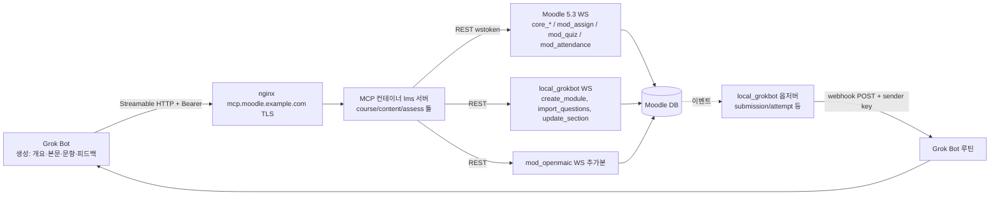

# Grok Bot ↔ Moodle 연동 조사 (2026-10-31)

## 1. 목적
Grok Bot이 Scott의 Moodle(moodle.example.com)에서 강좌/과제/채점/등록/공지를 조회·(승인 후) 조작하고, Moodle 이벤트로 알림 루틴을 실행하는 연동 방식 설계.

## 2. 방법
- lms 서버 SSH **읽기 전용** 점검(`www-data`로 `admin/cli/cfg.php` 조회, DB SELECT/COUNT만, 토큰 값 미조회). 설정 변경 없음.
- 웹 검색: GitHub Moodle MCP 서버, Moodle Events API, local_webhooks.
- Grok Bot 기능: 이 봇의 실제 툴/커넥터 카탈로그와 스킬 목록 기준(✅검증 / ⚠️추정 표기).

## 3. lms 서버 현황 (읽기 전용 확인, 2026-10-31 07:55 KST)
| 항목 | 값 |
|---|---|
| URL / 경로 | https://moodle.example.com, `/var/www/moodle` (5.1+ `public/` 구조) |
| 버전 | **Moodle 5.3 (Build 20261005)**, PHP 8.4.26 |
| 웹서비스 | `enablewebservices=1`, 프로토콜 **rest**, `enablemobilewebservice=1` |
| 외부 서비스 | `moodle_mobile_app`(함수 430, 토큰 0), `mod_attendance`(함수 8, 토큰 0) — 커스텀 서비스 없음 |
| 토큰 | **전체 0개** |
| AI 서브시스템 | `ai_providers` 레코드 없음(프로바이더 미설정) |
| 비코어 플러그인 | `mod_attendance` 2026090300, `mod_openmaic` 0.4.0(2026101601) |
| 웹훅 플러그인 | 없음(local_* 없음) |
| 이벤트 옵저버 | `mod_openmaic`: `\core\event\user_loggedout` 1개만 |
| 규모 | 강좌 6, 사용자 9 (테스트/초기 단계) |
| 기타 | 같은 서버에 Docker: `openmaic`, `litellm`, postgres 2개 |

`mod_openmaic`: `db/services.php` 없음(웹서비스 함수 미노출), `classes/local/{service_client,token,observer}.php`, privacy provider 있음 → OpenMAIC 서비스로 나가는 클라이언트 역할. **겹침**: 이벤트 옵저버/외부 호출 패턴. Grok Bot용 웹훅을 mod_openmaic에 넣지 말고 별도 `local_grokbot`(또는 local_webhooks)로 분리 권장.

## 4. Grok Bot 연동 옵션
| 옵션 | 내용 | 상태 |
|---|---|---|
| 커스텀 MCP 커넥터 | 원격(HTTP/SSE·Streamable HTTP) MCP 서버를 커넥터로 추가 → 툴로 호출. 인증: 헤더 토큰/OAuth | ⚠️추정(커넥터 추가 스킬 `add-connector` 존재 ✅, 세부 인증 방식은 문서 확인 필요) |
| 플러그인 카탈로그 | 현재 연결된 커넥터 목록에 Moodle 없음 | ✅(이 봇 카탈로그 기준). 카탈로그 전체 검색은 미실시 |
| 루틴 + 웹훅 트리거 | 외부 시스템이 루틴 웹훅 URL에 sender key와 함께 POST → 루틴 실행 | ⚠️추정(`routines` 스킬 존재 ✅, 페이로드 한도/키 방식 미검증) |
| 박스 CLI/스크립트 | 박스에서 curl/python으로 REST 직접 호출 | ✅ 가능(토큰 박스 저장 시 보안 주의) |
| 브라우저 자동화 | 박스 브라우저로 Moodle UI 조작 | ✅ 폴백. 느리고 깨지기 쉬움 |

## 5. Moodle 연동 지점
- **Web Services REST**: `/webservice/rest/server.php?wstoken=..&wsfunction=..&moodlewsrestformat=json`. 토큰은 외부 서비스+사용자 단위, 권한=토큰 사용자의 capability ∩ 서비스에 넣은 함수. 주요 함수: `core_course_get_courses_by_field`, `core_enrol_get_enrolled_users`, `mod_assign_get_assignments`, `mod_assign_get_submissions`, `mod_assign_get_grades`/`mod_assign_save_grade`, `gradereport_user_get_grade_items`, `mod_forum_add_discussion`(공지), `core_calendar_get_action_events_by_timesort`, `enrol_manual_enrol_users`. 코어 레이트리밋 없음 → 프록시에서 제한.
- **AI 서브시스템(4.5+)**: provider(OpenAI/Azure/Ollama 등) + placement(에디터, 강좌 도우미). Moodle *안에서* LLM을 쓰는 구조라 Grok Bot→Moodle 방향과는 별개. litellm이 이미 서버에 있어 OpenAI 호환 provider로 연결 가능(별도 과제).
- **이벤트/웹훅**: 코어에 아웃바운드 웹훅 없음. 방법 ① `local_webhooks`(5.3 지원 표기, 단 develop 브랜치는 전송 비활성 → 릴리스 버전만) ② 자체 `local_grokbot` 옵저버(`internal=>false`, adhoc task로 비동기 POST, HMAC).
- **LTI 1.3**: Moodle은 Platform·Tool 둘 다 가능. 챗봇 연동엔 과함(UI 임베드용). 나중에 "강좌 안 Grok 도우미" 필요 시 검토.
- **Mobile API**: `moodle_mobile_app` 서비스(430 함수)+`login/token.php`. 사용자 본인 권한으로 읽기 → 학생 관점 MCP(tcpassos)가 이 방식. 교수자 관리 작업엔 전용 서비스가 안전.

## 6. 기존 OSS Moodle MCP 서버 (2026-10 검색 기준)
| 저장소 | ★ | 생성/갱신 | 라이선스 | 툴 요약 | 비고 |
|---|---|---|---|---|---|
| loyaniu/moodle-mcp | 49 | 2025-04 생성 | 미표기 | 강좌/공지/과제/마감/연체/최근활동, 계획 생성 | Python, uvx, 학생 관점 |
| peancor/moodle-mcp-server | 44 | 2025-03 | MIT | 강좌, 학생목록, 제출물, **과제 채점·피드백**, 퀴즈 | Node, 교수자용, 단일 강좌 ID 고정 |
| 1alexandrer/moodle-mcp | 18 | 2026-04 | MIT | 14툴(강좌·파일·과제·성적·퀴즈·포럼·알림) | **Cloudflare Worker 원격 호스팅** 지원 |
| Snaw80/moodle-mcp | 4 | 2026-05 | MIT | site_info, 강좌, 과제, 퀴즈, 일정, 성적, 파일 | Python `uvx mcp-moodle` |
| tcpassos/moodle-student-mcp | 0 | 2026-06 | MIT | 학생 읽기 전용(모바일 서비스, SSO/MFA) | Node 22 |
마지막 커밋일은 미확인. 대부분 학생/stdio 위주 → 교수자용·원격·승인게이트 요건엔 **포크 또는 자체 구현** 필요(peancor+1alexandrer 참고).

## 7. 권장 아키텍처
```mermaid
flowchart LR
  G[Grok Bot] -- MCP over HTTPS + Bearer --> M[moodle-mcp 서버<br/>read 툴 / write 툴(확인 필요)<br/>PII 마스킹·감사로그·레이트리밋]
  M -- REST wstoken --> L[(Moodle 5.3 moodle.example.com<br/>서비스: grokbot_ro / grokbot_rw<br/>전용 사용자 svc_grokbot)]
  L -- 이벤트 옵저버 local_grokbot<br/>adhoc task, HMAC --> W[Grok Bot 루틴 웹훅<br/>sender key]
  W --> G
```
- **호스팅**: lms 서버 내 Docker 컨테이너(127.0.0.1 → Moodle 내부 호출) + 기존 리버스프록시에 `mcp.moodle.example.com` 새 vhost(TLS), 혹은 Cloudflare Worker. 기존 서비스(Hermes, Mac Studio, example.com) 미변경.
- **인증**: Grok Bot→MCP: 긴 랜덤 Bearer(또는 OAuth). MCP→Moodle: 서비스별 토큰(IP 제한 `iprestriction`, 만료일 설정).
- **보안(연구 단계 최소)**: ① Moodle 토큰·MCP 접속 키는 리포에 커밋하지 않고 env 파일만 사용 ② 실제 학생 데이터 유입 전 보안 재검토.
- **운영 전환 시**: 전용 최소권한 사용자·읽기/쓰기 서비스 분리, 쓰기 확인 절차, PII 마스킹·감사로그, 개인정보보호법(목적·최소수집·국외이전 고지/가명처리) 적용.

## 8. 단계와 담당
| # | 단계 | 담당 |
|---|---|---|
| 1 | Grok Bot 커스텀 MCP 인증 방식·루틴 웹훅 스펙 공식 확인, OSS 포크 대상 결정 | 연구팀 |
| 2 | Moodle에 `svc_grokbot` 사용자·역할·`grokbot_ro` 서비스·토큰 생성(Scott 승인 후) | 엔지니어 bot |
| 3 | MCP 서버 구현(읽기 툴, 마스킹, 감사로그, 테스트) | 개발자 bot |
| 4 | 컨테이너 배포·vhost/TLS·Bearer, Grok Bot 커넥터 등록 | 엔지니어 bot |
| 5 | `local_grokbot` 이벤트→웹훅 플러그인(또는 local_webhooks 도입) | OpenMAIC Moodle 개발 bot(플러그인 경험) / 개발자 bot |
| 6 | 쓰기 툴(`grokbot_rw`) + 확인 플로우 | 개발자 bot |
| 7 | Canvas 이식 검토 | 연구팀 |

## 9. 우선순위
- **P0(읽기)**: 내 강좌·과제 목록/마감, 과제별 제출·미채점 현황, 수강생 수/명단(마스킹), 일정.
- **P1(알림·다이제스트)**: 제출 발생/마감 임박 웹훅→루틴, 매일 아침 제출 다이제스트, 미채점 리마인더.
- **P2(쓰기, 확인 필수)**: 공지 게시(news forum), 성적·피드백 입력, 수동 등록/해제, OpenMAIC 활동 생성.

## 10. 주의사항
- 토큰·접속 키는 리포 커밋 금지(env만). admin 토큰·`moodle_mobile_app` 토큰은 MCP에 쓰지 않기.
- 실제 학생 데이터 유입 전 보안 재검토(위 "운영 전환 시").
- mod_openmaic과 이름·책임 분리, local_webhooks는 안정 릴리스만, OSS MCP는 코드 리뷰 후 사용.
- Canvas: 같은 MCP 래퍼 패턴 이식 가능하나 기관 토큰 정책 확인 전까진 브라우저 방식 유지.

## 11. Scott께 질문
1. MCP 서버 호스팅 위치: lms 서버 내 컨테이너 vs Cloudflare Worker vs 다른 곳? 새 서브도메인 사용 가능?
2. 첫 단계 범위: 읽기 전용만(P0/P1)으로 시작해도 되나? 쓰기(성적·공지·등록)는 언제/어떤 확인 방식?
3. 실제 학생 데이터가 들어오나(현재 사용자 9명)? 외부 AI로 학생 이름·성적 전송 허용 범위(가명처리 필요 여부)?
4. 이벤트 웹훅: 자체 `local_grokbot` vs `local_webhooks` 설치, 어느 쪽 선호? OpenMAIC 봇에 맡길지?

## 12. 출처
- https://github.com/loyaniu/moodle-mcp
- https://github.com/peancor/moodle-mcp-server
- https://github.com/1alexandrer/moodle-mcp
- https://github.com/Snaw80/moodle-mcp
- https://github.com/tcpassos/moodle-student-mcp
- https://docs.moodle.org/dev/Events_API
- https://marketplace.moodle.com/plugins/local_webhooks , https://code.popov.link/moodle/local_webhooks/src/branch/develop
- 함수 존재 확인: lms 서버 `mdl_external_functions` 읽기 조회(2026-10-31)
- https://moodledev.io/docs/apis/subsystems/external/functions (미열람 참조)
- https://docs.moodle.org/dev/Web_services , https://docs.moodle.org/en/AI_subsystem , https://docs.moodle.org/en/LTI_and_Moodle (일반 참조, 이번에 열람 안 함)

---
## Scott 결정 (2026-10-31 08:03 KST)
- MCP 서버는 moodle.example.com 서버(<SERVER_IP>)에 둔다.
- 연구용이므로 권한 분리나 보안 강화는 최소로 한다. 다만 아래 두 가지는 비용이 거의 안 드니 유지를 권한다.
  1. 토큰과 MCP 접속 키는 리포에 커밋하지 않고 env 파일로만 관리한다.
  2. 실제 학생 데이터가 들어오기 전에 보안 항목을 다시 검토한다.
- 그 밖의 보안 관련 주의점(최소권한, 쓰기 확인, 가명처리)은 운영 전환 때 다시 적용한다.

---
## 13. 배치 검토: MCP 서버를 lms 서버에 두는 안 (2026-10-31 08:05 KST 확인)
**서버 현황(읽기 전용)**: 6 vCPU, RAM 12GB(가용 약 4.3GB), 디스크 89GB 여유, load 1.5~2.0. 컨테이너 litellm(722MB/1GB 제한), openmaic(234MB), postgres 2개. nginx sites: `bot`, `llm`, `moodle` (**`bot` vhost가 이 서버에 있음 → 기존 설정 파일은 수정 금지, 새 파일만 추가**).

- **접속 경로**: Grok Bot → `https://mcp.moodle.example.com/mcp`(Streamable HTTP, 새 nginx server 블록 + Let's Encrypt TLS) → 127.0.0.1:포트의 MCP 컨테이너. 인증은 Bearer 헤더(Grok Bot 커스텀 커넥터의 헤더/OAuth 지원 범위는 ⚠️미검증).
- **Moodle REST 호출**: 컨테이너 → 공개 URL(`https://moodle.example.com/webservice/rest/server.php`) 호출이 가장 단순(TLS·wwwroot 일치, 파일 URL 그대로 사용). 로컬(127.0.0.1 + Host 헤더) 호출은 지연이 조금 줄 뿐 이득 작고 wwwroot/리다이렉트 이슈 가능 → **공개 URL 권장**, 토큰 `iprestriction`에 서버 IP 지정 가능.
- **자원 영향**: MCP 서버는 Node/Python 1개 프로세스, 100~200MB 수준. AI 생성은 Grok Bot 쪽에서 하므로 서버 부하는 REST 호출뿐 → 영향 미미. 컨테이너에 메모리 제한(예: 256MB) 권장.
- **장점**: 지연·네트워크 단순, 이후 `local_grokbot` 플러그인과 같은 곳에서 관리, 별도 비용 없음, litellm 재사용 가능. **단점**: Moodle과 장애·보안 영역 공유(MCP 침해 = Moodle 토큰 노출), 서버 업그레이드 시 함께 영향.
- **대안**: Cloudflare Worker(서버 무부하, 상태 저장 불편, Moodle 파일 업로드 처리 번거로움) / 별도 VPS(격리 좋으나 비용·운영 증가) / 박스 로컬 stdio(Grok Bot 원격 커넥터로 쓰기 어려움).
- **판정**: 연구 단계에는 **적합**. Docker 컨테이너 + 새 서브도메인 vhost로 기존 서비스(bot/llm/moodle) 무변경 유지. 실학생 운영 전환 시 격리(별도 호스트) 재검토.

## 14. 교사 계정 기반 MCP 중심 구조 (수업 설계 · 콘텐츠 개발 · 학생 평가)
원칙: **Grok Bot이 생성(개요·본문·문항·피드백 초안), MCP는 쓰기만**. MCP 툴은 "구조화된 JSON 입력 → Moodle WS 호출"의 얇은 래퍼. 토큰 사용자 = 교사 계정(연구 단계), 강좌 생성 등은 매니저/코스크리에이터 권한 필요.
함수 존재 여부: lms 서버 `mdl_external_functions`(총 768개)에서 확인 = ✅, 미존재/동작 미확인 = ⚠️.

### (a) 수업 설계
| MCP 툴 | Moodle 함수 | 커버 |
|---|---|---|
| `create_course` | `core_course_create_courses` ✅ (섹션 수 `numsections` 지정) | 코어 |
| `update_course` | `core_course_update_courses` ✅ (요약·기간 등) | 코어 |
| `add_section` / `rename_section` / `move_section` | `core_courseformat_update_course` ✅ (action 기반: section_add/… — 지원 action 목록 ⚠️미검증) | 코어(부분) |
| `set_section_summary` | 코어 WS로 섹션 요약 HTML 수정 불가로 판단 ⚠️ → `local_grokbot_update_section` | **커스텀** (`local_wsmanagesections` 유사) |
| `hide/show/delete_section` | `core_course_edit_section` ✅ (action 전용) | 코어 |
| `get_course_outline` | `core_course_get_contents` ✅ | 코어 |
AI 단계: Grok Bot이 주차별 목표·개요 JSON 생성 → `create_course` → 섹션 일괄 이름/요약 설정.

### (b) 콘텐츠 개발
| MCP 툴 | Moodle 함수 | 커버 |
|---|---|---|
| `upload_file` | `core_files_upload` ✅ / `webservice/upload.php` (draft 영역) | 코어 |
| `create_page` / `create_url` / `create_resource` | 코어에 설정 포함 모듈 생성 WS 없음. `core_courseformat_create_module` ✅는 빈 모듈 퀵생성용(지원 모듈 제한 ⚠️) | **커스텀** `local_grokbot_create_module` (`create_module()`/`add_moduleinfo` 래핑) |
| `create_quiz` | 위와 동일 | **커스텀** |
| `import_questions` (GIFT/Moodle XML/Aiken) | `core_question_import` ❌ 없음. 문항 생성 WS 없음 | **커스텀** `local_grokbot_import_questions` (qformat 사용) |
| `add_questions_to_quiz` | `mod_quiz_add_random_questions` ✅(랜덤만), 개별 추가 WS 없음 ⚠️ | **커스텀** (`quiz_add_quiz_question`) |
| `create_openmaic_lecture` | mod_openmaic에 `db/services.php` 없음 | **커스텀**: OpenMAIC Moodle 개발 bot이 `mod_openmaic_create_lecture`(또는 generate 트리거) WS 추가 |
| `update_module_content` | `core_course_edit_module` ✅(show/hide/duplicate 등 action만) | 내용 수정은 **커스텀** |
AI 단계: Grok Bot이 페이지 HTML·GIFT 문항·OpenMAIC 강의 프롬프트 생성 → MCP가 업로드/생성.

### (c) 학생 평가
| MCP 툴 | Moodle 함수 | 커버 |
|---|---|---|
| `list_assignments` | `mod_assign_get_assignments` ✅ | 코어 |
| `get_submissions` | `mod_assign_get_submissions` ✅ (+파일 URL 다운로드) | 코어 |
| `grade_submission` / `bulk_grade` | `mod_assign_save_grade` ✅ / `mod_assign_save_grades` ✅ (피드백 코멘트 포함) | 코어 |
| `list_quiz_attempts` / `review_attempt` | `mod_quiz_get_quizzes_by_courses` ✅, `mod_quiz_get_user_attempts` ✅, `mod_quiz_get_attempt_review` ✅ | 코어 (전체 응답 리포트는 사용자별 반복 → 집계 툴은 커스텀 권장) |
| `gradebook_overview` | `gradereport_user_get_grade_items` ✅, `gradereport_grader_get_users_in_report` ✅ | 코어 |
| `set_manual_grade` | `core_grades_update_grades` ✅ (외부 grade item용, 수동 항목은 ⚠️) | 코어/부분 |
| `attendance_sessions` / `mark_attendance` | `mod_attendance_add_attendance`·`add_session`·`get_sessions`·`get_session`·`update_user_status` ✅ | 플러그인 기존 WS |
| `list_students` | `core_enrol_get_enrolled_users` ✅ | 코어 |
AI 단계: MCP가 제출물·루브릭 읽기 → Grok Bot이 점수·피드백 초안 → Scott 확인 → `bulk_grade`.

### 구조도


### 단계·담당·우선순위 (갱신)
| P | 단계 | 담당 |
|---|---|---|
| P0 | Grok Bot 커스텀 MCP 커넥터 인증·루틴 웹훅 스펙 확인, `core_courseformat_update_course` action 목록·`create_module` 지원 범위 검증 | 연구팀 |
| P0 | lms에 웹서비스 서비스·교사 토큰 생성, nginx 새 vhost + TLS, MCP 컨테이너 배포 틀 | 엔지니어 bot |
| P0 | MCP 서버: 조회 툴 + (c) 평가 코어 툴(제출 조회·채점·출석) | 개발자 bot |
| P1 | (a) 수업 설계 툴(create_course, 섹션) + `local_grokbot_update_section` | 개발자 bot |
| P1 | `local_grokbot`: `create_module`(page/url/resource/quiz/assign), `import_questions`, 이벤트 옵저버→웹훅 | 개발자 bot |
| P1 | `mod_openmaic` WS(강의 생성/생성 상태 조회) | OpenMAIC Moodle 개발 bot |
| P2 | 퀴즈 개별 문항 추가·리포트 집계, 다이제스트 루틴, 운영 전환 보안 재검토 | 개발자 bot / 연구팀 |
